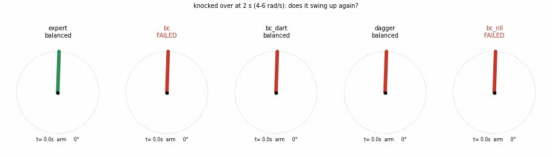
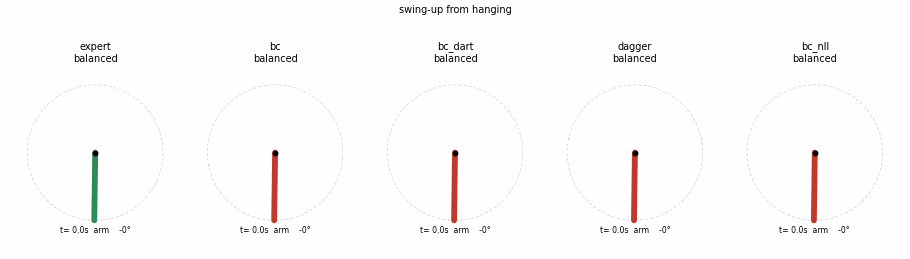

# BC_Pendulum — Behavior Cloning + DAgger로 회전형 진자 스윙업

[](https://colab.research.google.com/github/jooyongsim/Pendulum_control/blob/sumin/BC_Pendulum/bc_rotary_swingup_colab.ipynb)

신경망이 우리 스윙업 제어기(에너지 펌핑 + 4상태 극 배치)를 흉내 내도록 학습하고,
시뮬레이터에서 확인한 뒤 실제 장비(STEVAL-EDUKIT01)에서 실행합니다.

| 파일 | 내용 |
|---|---|
| `bc_rotary_swingup_colab.ipynb` | **Colab 노트북** — 시연 수집 → BC → DART → DAgger → 비교 → weight 다운로드. 파일 하나로 동작 |
| `bc_rotary_swingup.py` | 같은 내용의 스크립트 + 실시간 시뮬 데모 |
| `rotary_model.py` | 시뮬레이터: 측정한 장비 모델(ω_n 7.499, ζ 0.0117, b 0.730) + 펌웨어 한계 + 50 Hz/4 ms 지연/0.3° 엔코더 |
| `bc_real_swingup.py` | 학습한 weight를 실제 장비에서 실행 (`swing-up/` 의 시작 절차·안전장치 사용) |
| `bc_models/` | 학습된 weight (`.npz` = numpy, `.pt` = torch) |

## 강의 대응 (Lec05, Lec06)
| 강의 | 여기서 |
|---|---|
| 전문가 시연 수집 | 우리 스윙업 제어기를 시뮬에서 돌려 `(관측, 행동)` 수집. 관측 `[cos θ, sin θ, θ̇, φ, φ̇]`, 행동 `u / 47.1` |
| version 0: ℓ2 회귀 | `bc` — MSE (= 가우시안 잡음 가정의 최대우도) |
| version 1: 분포 출력 | `bc_nll` — 평균과 σ 출력, 로그확률 최대화 |
| compounding error → 교정 데이터 | `bc_dart` (시연에 노이즈), `dagger` (학생이 간 상태에 전문가 정답 추가) |

신경망: 5 → 128 → 128 → 1 (ReLU), 출력 `tanh`, 50 Hz.

## 시뮬 결과 (각 20회)
| | 스윙업 | 쓰러뜨린 뒤 회복 | b −20% | 지연 12 ms |
|---|---|---|---|---|
| 전문가 | 100% | 100% | 100% | 70% |
| bc | 100% | 30% | 90% | 5% |
| bc_dart | 100% | 100% | 100% | 100% |
| **dagger** | 100% | 100% | 100% | 95% |
| bc_nll | 15% | 40% | 0% | 65% |

**같은 상황에서 다섯 가지 비교** (2초에 쓰러뜨림 → 다시 올리나?)



**매달림에서 스윙업**



그냥 BC는 시연과 비슷한 상황만 되고, 처음 보는 상황(쓰러뜨리기, 지연)에서 실수가 쌓여 실패합니다. DART와 DAgger가 이를 해결합니다.

## 실행
```bash
cd BC_Pendulum
python3 bc_rotary_swingup.py train      # 학습 (약 2분, bc_models/ 덮어씀)
python3 bc_rotary_swingup.py eval       # 비교표
python3 bc_rotary_swingup.py demo       # 실시간 시뮬 창 (↑ 쓰러뜨리기, ←/→ 살짝 치기, m 모델 바꾸기, r 리셋)
```

## 실제 장비
`swing-up/SwingupController` 펌웨어를 올리고, 진자를 매단 채 보드 리셋 후:
```bash
python3 BC_Pendulum/bc_real_swingup.py --duration 20                                          # DAgger
python3 BC_Pendulum/bc_real_swingup.py --model BC_Pendulum/bc_models/rotary_bc_bc_dart.npz    # 다른 weight
```
수직 측정 후 Enter를 누르면 시작, Ctrl+C로 정지. 기록은 `BC_Pendulum/data/`.
