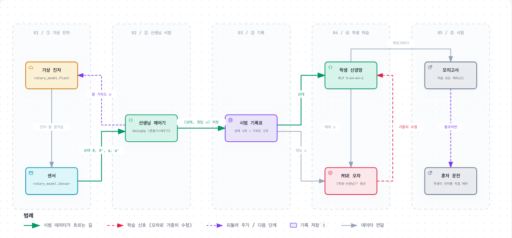

# 진자 행동 복제 (Behavior Cloning)

> 잘하는 제어기(선생님)의 행동을 신경망(학생)이 보고 따라 하게 만든다.
> 모든 과정은 **컴퓨터 속 가짜 진자(시뮬레이터)** 안에서만 일어난다. 실제 장비는 움직이지 않는다.



움직이는 확대·축소 버전: [`diagram/bc_pipeline.html`](diagram/bc_pipeline.html) (브라우저로 열기, [Archify](https://github.com/tt-a1i/archify)로 그림)

---

## 한 문장으로

"이 상황에서 선생님은 팔을 이만큼 밀었다"는 기록을 수만 개 모아서, 신경망이 **상황만 보고 같은 답을 내도록** 연습시킨다.

운전 연수와 비슷하다. 강사(선생님)가 운전하는 동안 "이 길 상황에서 핸들을 이만큼 돌렸다"를 계속 적어 두고, 학생은 그 기록표로 공부한다. 공부가 끝나면 학생 혼자 운전대를 잡아 본다.

## 등장인물

| 그림 속 이름 | 실제로는 | 하는 일 |
|---|---|---|
| **가상 진자** | `simulator/rotary_model.py`의 `Plant` | 진짜 장비에서 잰 값(흔들리는 빠르기, 마찰, 모터 한계)으로 만든 가짜 진자. 0.001초마다 물리 계산을 한다. |
| **센서** | `Sensor` | 진짜 장비처럼 각도를 0.3° 단위로 끊어 읽고, 속도는 각도 차이로 계산한다. 0.01초마다 읽는다. |
| **선생님 제어기** | `SwingUp` | 실제 장비에서 쓰는 스윙업 제어기. 진자를 그네처럼 흔들어 올리고(흔들기), 꼭대기 근처에서 받아 세운다(세우기). |
| **시범 기록표** | 메모리 속 표 | 한 줄 = (그 순간의 상태 4개, 선생님이 낸 팔 가속도 1개) |
| **학생 신경망** | `Policy` (MLP) | 상태를 넣으면 팔 가속도 하나를 내놓는 작은 신경망 |
| **MSE 오차** | `mse_loss` | 학생 답과 선생님 답이 얼마나 다른지 채점하는 점수 |

## 상태 4개 = 학생이 보는 정보

| 기호 | 뜻 | 비유 |
|---|---|---|
| θ (세타) | 막대(진자) 각도. 0이면 똑바로 섬, ±180°면 축 늘어져 매달림 | 막대가 얼마나 기울었나 |
| θ' (세타 닷) | 막대가 넘어가는 속도 | 얼마나 빨리 기울고 있나 |
| φ (파이) | 팔(모터) 각도 | 손이 가운데서 얼마나 벗어났나 |
| φ' (파이 닷) | 팔이 도는 속도 | 손이 얼마나 빨리 움직이나 |

**학생의 답 = 팔 가속도 u** (팔을 얼마나 세게 밀지, 단위 rad/s²)

막대 각도는 `sin θ`, `cos θ` 두 숫자로 바꿔서 넣는다. +179°와 -179°는 사실 거의 같은 자세인데 숫자로는 358이나 차이 나 보이기 때문이다. sin, cos로 바꾸면 두 자세가 비슷한 숫자가 된다.

## 단계별로

### ① 선생님 시범 모으기

선생님 제어기가 가상 진자를 15초씩 **40번** 운전한다. 0.01초마다 (상태, 선생님 답)을 한 줄씩 적는다.

매번 똑같으면 학생이 한 장면만 외우기 때문에, 시범마다 조건을 조금씩 바꾼다.
- 진자가 매달린 채 살짝 기운 정도 (0.5~3°, 왼쪽/오른쪽)
- 모터가 막대를 미는 세기 b (±10%)
- 마찰 (0.5~2배)
- 4~7초마다 진자를 **툭 친다**. 넘어졌다가 다시 흔들어 올리는 장면도 배우게 하려는 것이다.

처음 0.3초 동안 선생님은 상태와 상관없이 정해진 대로 팔을 한 번 앞뒤로 흔든다(시동 걸기). 상태를 보고 낸 답이 아니라서 이 부분은 기록에서 뺀다.

### ② 연습 문제와 모의고사 나누기

40번 시범 중 **32번은 연습용**(학습), **8번은 모의고사용**(검증)으로 따로 둔다. 모의고사는 학생이 공부할 때 한 번도 보지 않은 시범이라서, 외운 것이 아니라 정말 이해했는지 확인할 수 있다.

### ③ 학생 공부시키기 (MSE)

1. 학생에게 상태를 보여 주고 답(팔 가속도)을 내게 한다.
2. 선생님 답과 비교해 **차이를 제곱해서 평균**을 낸다. 이것이 **MSE**(Mean Squared Error, 평균 제곱 오차)다.
   - 차이를 제곱하므로 크게 틀린 답일수록 훨씬 큰 벌점을 받는다.
   - 0이면 선생님과 완전히 똑같다는 뜻이다.
3. 이 점수가 줄어드는 방향으로 신경망 안의 숫자(가중치)를 조금 고친다 (Adam 최적화).
4. 256문제씩 묶어서 이 과정을 반복한다. 연습 문제를 **처음부터 끝까지 한 바퀴 푸는 것을 1 에포크**라고 한다.

답은 모터의 최대 가속도(47.1 rad/s²)로 나눈 값으로 비교한다. 그래서 MSE 0.01은 "평균적으로 최대 가속도의 약 10%만큼 틀린다"는 뜻이다.

### ④ 시험 두 가지

- **모의고사(검증 MSE):** 처음 보는 시범에서 선생님 답과 얼마나 다른가
- **혼자 운전:** 선생님 없이 학생 신경망이 직접 가상 진자를 15초 동안 운전한다. 처음 0.3초 시동만 선생님이 걸어 준다. 꼭대기(12° 이내)까지 올리고 버티는지 본다.

## 결과 (2026-10-13 실행)

| | 모의고사 MSE | 평균 오차 | 혼자 운전 |
|---|---|---|---|
| 공부 전 (무작위 신경망) | 0.205 | — | — |
| 참고: 항상 0이라고 답하기 | 0.101 | — | — |
| **1 에포크** | **0.061** | 11.7 rad/s² | 못 올림 (팔 한계 140°에 닿아 정지) |
| 30 에포크 | 0.015 | 5.7 rad/s² | **3.45초 만에 올리고**, 15초 중 11.6초를 서 있음 |

- 1 에포크(약 3만 문제 한 바퀴)만으로도 오차가 공부 전의 1/3 이하로 줄었다. **학습 코드가 제대로 돌아간다**는 확인이다.
- 1 에포크로는 아직 서툴러서 혼자 운전하면 실패한다. 30 에포크쯤 공부하면 시뮬레이터 안에서 혼자 진자를 세운다.
- 숫자는 `--seed 0`(기본값) 기준이다. 같은 명령을 다시 실행하면 같은 결과가 나온다.

### 몇 에포크가 좋을까

100 에포크까지 돌려 본 모의고사 MSE: 30 → 0.015, 50 → 0.012, 80 → 0.010, 90 → 0.009, 100 → 0.011.
70~90 에포크 무렵 모의고사 점수가 더 나아지지 않는다. 연습 문제 점수는 계속 좋아지는데 모의고사는 오히려 살짝 나빠지면, 문제를 외우기 시작했다는 신호다.
그래서 **80 에포크**를 권한다. 100 에포크도 이 Mac에서 시범 수집까지 합쳐 41초면 끝난다.

### Colab에서 학습한 모델 성적 (`bc_play.py --check`)

학습 때처럼 시작 조건(기울기, 모터 세기 b, 마찰)을 무작위로 바꾼 20가지 경우에서, 같은 조건으로 학생과 선생님을 각각 15초씩 운전시켰다.

| | 올려서 끝까지 유지 | 처음 올린 시간 (중앙값) | 15초 중 서 있던 시간 (평균) |
|---|---|---|---|
| 학생 (Colab 모델) | 16/20 | 2.98초 | 9.7초 |
| 선생님 | 20/20 | 2.38초 | 12.5초 |

- 성공한 16번은 선생님과 거의 같다. 15초 중 약 12초를 서 있었고, 팔은 오히려 덜 움직였다 (최대 44~78°).
- 실패한 4번은 올리는 도중이나 받은 직후 팔이 한쪽으로 밀려 팔 한계(140°)에 닿았다. 그중 3번은 모터 세기 b가 범위의 낮은 쪽(0.66~0.69)일 때였다.

## 실행 방법

conda 환경 `pendulum`에서 저장소 최상위 폴더 기준으로 실행한다.
이 환경에는 PyTorch 2.2.2가 설치돼 있다 (Intel Mac용 마지막 버전이라 NumPy 1.x가 필요하다).

```bash
conda activate pendulum
python behavior_cloning/bc_train.py               # 1 에포크 (약 20초)
python behavior_cloning/bc_train.py --epochs 80   # 권장 (위 '몇 에포크가 좋을까')
```

| 옵션 | 기본값 | 뜻 |
|---|---|---|
| `--epochs` | 1 | 연습 문제를 몇 바퀴 풀지 |
| `--episodes` | 40 | 선생님 시범 횟수 |
| `--duration` | 15 | 시범 하나의 길이 [초] |
| `--lr` | 0.001 | 한 번에 가중치를 얼마나 크게 고칠지 |
| `--seed` | 0 | 무작위 조건을 정하는 번호 (같은 번호 = 같은 결과) |
| `--no-rollout` | | 마지막 "혼자 운전" 시험 건너뛰기 |

학습된 신경망은 `behavior_cloning/output/bc_policy.pt`에 저장된다.

**학습된 모델 돌려 보기** (`bc_play.py`):

```bash
python behavior_cloning/bc_play.py           # 창이 뜨고 신경망이 진자를 운전 (t: 선생님과 바꾸기, ←/→: 툭 치기)
python behavior_cloning/bc_play.py --check   # 창 없이 20가지 시작 조건에서 선생님과 성적 비교
```

**Colab에서:** [colab.research.google.com](https://colab.research.google.com) → 파일 → 노트북 업로드 → `bc_train_colab.ipynb` → 런타임 → 모두 실행.
4번 셀의 `--epochs 30`을 `--epochs 80`으로 바꾸고, 마지막 셀에서 받은 `bc_policy.pt`를 `behavior_cloning/output/`에 넣으면 `bc_play.py`로 바로 돌려 볼 수 있다.
노트북 안에 시뮬레이터와 학습 코드가 들어 있어서 다른 파일은 올리지 않아도 된다.
`bc_train.py`나 `rotary_model.py`를 고쳤다면 노트북도 다시 만들어야 한다 (두 `%%writefile` 셀에 내용이 그대로 들어 있다).

## 파일

```
behavior_cloning/
├── bc_train.py             시범 수집 → 학습 → 시험 (이 파일 하나로 전부)
├── bc_play.py              학습된 신경망을 시뮬레이터에서 운전 (창 / --check 성적표)
├── bc_train_colab.ipynb    Colab용 노트북 (시뮬레이터·학습 코드 내장)
├── README.md               이 문서
├── output/bc_policy.pt     학습된 신경망 (지금은 Colab에서 학습한 것)
└── diagram/
    ├── bc_pipeline.png      위 그림
    ├── bc_pipeline.html     확대 가능한 그림 (Archify)
    └── candidate.json       그림의 원본 설정 (고쳐서 다시 그릴 때 사용)
```

## 알아 둘 한계

- **선생님은 "기억"이 있다.** 같은 각도라도 지금 흔드는 중인지 세우는 중인지(모드)에 따라 다른 답을 낸다. 학생은 지금 상태만 보므로, 12~30° 사이 애매한 구간에서는 선생님을 완벽히 따라 할 수 없다.
- **학생은 본 것만 안다.** 시범에 없던 상황, 예를 들어 팔이 한쪽 끝에 몰린 상태에 놓이면 엉뚱한 답을 낼 수 있다. 이 상황을 줄이려고 툭 치기와 조건 바꾸기를 넣었지만, 위 성적표의 실패 4번처럼 모터가 약한 쪽 조건에서는 아직 약하다.
- **실제 장비에서는 아직 시험하지 않았다.** 시뮬레이터는 실제 장비를 꽤 닮았지만 똑같지는 않다. 장비에 올리기 전에 시뮬레이터에서 충분히 성공하는지 먼저 확인해야 한다.
