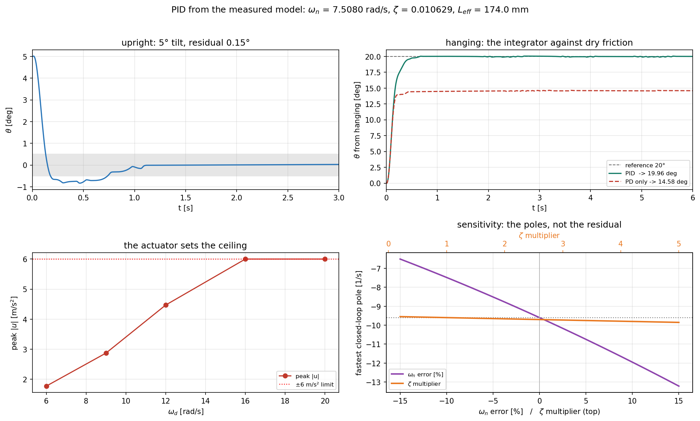

# 측정한 $\omega_n,\ \zeta$ 로 PID 설계하기

자유 진동 실험에서 얻은 값 **두 개만으로** 직립·매달림 두 동작점의 PID 게인을 닫힌 형태로
계산하고, 그 설계가 실제 루프(100 Hz, 0.3° 엔코더, ±6 m/s², 건마찰)에서 어떻게 동작하는지,
그리고 **측정이 틀렸을 때 얼마나 흔들리는지**까지 확인한다.

- 코드: [`../analysis/pid_from_measurement.py`](../analysis/pid_from_measurement.py)
- 측정값 출처: [`pendulum_model_identification.md`](pendulum_model_identification.md)
- 직립 전용 설계(캐스케이드 포함): [`pendulum_pid_design.md`](pendulum_pid_design.md)

```bash
cd analysis
python pid_from_measurement.py --no-show     # 표 + pid_from_measurement.png
```

> 수식 안에 한글을 넣지 않았다. KaTeX 는 라틴·그리스 글꼴만 갖고 있어서 한글이 수식에
> 들어가면 뷰어에 따라 깨진다.

---

## 1. 측정한 것

| 값 | 기호 | 어디서 나왔나 |
| --- | --- | --- |
| 7.5080 rad/s | $\omega_n$ | 극값 간격 회귀 ($T_0$ = 0.8369 s) |
| 0.010629 | $\zeta$ | 포락선 피팅 |
| 0.0798 1/s | $\sigma = \zeta\omega_n$ | 위 두 값 |
| 173.97 mm | $L_{\text{eff}} = g/\omega_n^2$ | $\omega_n$ 에서 유도 |
| 3.149 deg/s | Coulomb | 포락선의 직선 성분 (0.6482 rad/s²) |

설계에 들어가는 것은 $\omega_n,\ \zeta$ 뿐이고 $L_{\text{eff}}$ 는 그 둘에서 나온다.
**질량도 관성모멘트도 필요 없다.** 입력 이득 $-1/L_{\text{eff}} = -5.748$ 까지 자유 진동만으로
결정된다.

---

## 2. 두 동작점, 하나의 공식

$u$ 를 피벗 가속도 $[\mathrm{m/s^2}]$ 라 하면 선형화된 진자는

$$\text{hanging:}\quad \ddot\theta = -\omega_n^2\theta - 2\sigma\dot\theta - \frac{u}{L}$$

$$\text{upright:}\quad \ddot\theta = +\omega_n^2\theta - 2\sigma\dot\theta - \frac{u}{L}$$

**중력 항의 부호 하나만 다르다.** 그래서 게인 공식도 하나로 덮인다. PID 를 넣으면 닫힌 루프는
3차가 되고

$$s^3 + \left(2\sigma + \frac{k_d}{L}\right)s^2
+ \left(\frac{k_p}{L} \mp \omega_n^2\right)s + \frac{k_i}{L} = 0$$

(위 부호가 upright, 아래가 hanging) 이며, 원하는 다항식
$(s^2 + 2\zeta_d\omega_d s + \omega_d^2)(s + \omega_i)$ 와 계수를 맞추면

$$k_d = L\,(2\zeta_d\omega_d + \omega_i - 2\sigma)$$

$$k_p = L\,(\omega_d^2 + 2\zeta_d\omega_d\,\omega_i \pm \omega_n^2)$$

$$k_i = L\,\omega_d^2\,\omega_i$$

코드에서는 `place_pid(wn, zeta, wd, zd, wi, upright)` 한 함수이고, 부호는 `upright` 플래그
하나로 갈린다.

### 사양과 결과

$\omega_d = 12$ rad/s, $\omega_i = 4$ rad/s, $\zeta_d$ 는 직립 0.8 / 매달림 0.7.

| 동작점 | $k_p$ | $k_i$ | $k_d$ | 극점 배치 |
| --- | --- | --- | --- | --- |
| upright | 48.219 | 100.21 | 4.0083 | 요청과 정확히 일치 |
| hanging | 26.936 | 100.21 | 3.5908 | 요청과 정확히 일치 |

단위는 rad 당 $\mathrm{m/s^2}$. 두 설계의 차이는 정확히 $2L\omega_n^2 = 19.61$ 이다 —
**중력이 직립에서는 적이고 매달림에서는 아군**이기 때문에 $k_p$ 가 그만큼 차이 난다.
직립에서는 $k_p$ 의 20 % 가 중력을 상쇄하는 데 쓰인다.

> `pendulum_sim.place_pid()` 와 upright 결과가 일치하는지 스크립트가 `assert` 로 확인한다.

---

## 3. 실제 루프에서

100 Hz, 0.3° 엔코더, ±6 m/s² 포화, 미분 필터 10 ms, 건마찰 포함.

| 케이스 | 정착 오차 | 최대 $u$ | 포화 | 로터 |
| --- | --- | --- | --- | --- |
| upright, 5° 기울기 | 0.150° | 4.47 | 0 % | 675° |
| hanging, 20° 기준, PID | **−0.040°** | 6.00 | 1 % | 41182° |
| hanging, 20° 기준, PD only | **−5.42°** | 6.00 | 1 % | 30302° |

### 적분기가 하는 일이 여기서 분명하다

매달림에서 20° 를 유지하려면 중력 성분을 계속 이겨야 한다. PD 만으로는 **5.42° 모자란
곳에서 멈춘다** — 오차가 있어야만 토크가 나오기 때문이다. 적분기를 넣으면 0.04° 안으로
들어온다. 5° 기준으로 낮춰도 같은 구조다 (PD −1.32°, PID +0.03°).

### 로터 열은 버그가 아니라 물리다

매달림에서 기준각 $\theta_r$ 을 유지하려면 정상상태에서

$$u = g\sin\theta_r = 3.35\ \mathrm{m/s^2}\quad(\theta_r = 20°)$$

를 **영원히** 유지해야 하고, $u$ 는 팔 각도로 두 번 적분된다. 그래서 회전형 장비는 기울어진
기준각을 무한히 유지할 수 없다. 이 문제는 토크로 피벗을 직접 구동하는 장비의 것이고,
우리 장비에서는 직립 안정화(기준각 0)가 본래의 과제다.

---

## 4. $\omega_d$ 는 어디까지 올릴 수 있나

직립, 5° 기울기, $\omega_i = \omega_d/3$:

| $\omega_d$ | $k_p$ | $k_i$ | $k_d$ | 잔류 | 최대 $u$ | 포화 |
| --- | --- | --- | --- | --- | --- | --- |
| 6 | 19.41 | 12.53 | 1.990 | 0.179° | 1.77 | 0 % |
| 9 | 31.41 | 42.27 | 2.999 | 0.160° | 2.87 | 0 % |
| **12** | 48.22 | 100.21 | 4.008 | 0.150° | 4.47 | 0 % |
| 16 | 78.10 | 237.53 | 5.354 | 0.126° | **6.00** | 0 % |
| 20 | 116.51 | 463.92 | 6.699 | 0.281° | 6.00 | 1 % |

**한계를 정하는 것은 측정이 아니라 구동기다.** 16 rad/s 부터 명령이 ±6 에 닿고, 20 에서는
포화가 시작되며 잔류 오차가 오히려 커진다. 12 rad/s 가 권한의 25 % 를 외란용으로 남긴다.

---

## 5. 측정이 틀렸다면

측정값으로 설계한 게인을 **다른 진짜 플랜트**에 걸어 본다.

| 진짜 플랜트 | 잔류 | 닫힌 루프 극점 실수부 |
| --- | --- | --- |
| 측정값 그대로 | 0.050° | −9.6, −9.6, −4.0 |
| $\omega_n$ +5 % | 0.011° | −10.75, −10.75, −4.07 |
| $\omega_n$ −5 % | 0.110° | −8.51, −8.51, −3.92 |
| $\omega_n$ +10 % | 0.113° | −11.95, −11.95, −4.15 |
| $\zeta \times 3$ | 0.044° | −9.73, −9.73, −4.06 |
| $\zeta \times 1/3$ | 0.056° | −9.56, −9.56, −3.98 |

**$\zeta$ 는 거의 아무것도 바꾸지 않는다.** $\zeta$ 가 들어가는 곳은 $k_d$ 의 $-2\sigma$ 항
하나뿐이고, 그 크기가 $0.16$ 인데 $2\zeta_d\omega_d + \omega_i = 23.2$ 와 비교하면 0.7 % 다.
$\zeta$ 를 세 배로 틀려도, 1/3 로 틀려도 극점이 1 % 안에서 움직인다.

이것이 왜 중요한가 — 동정 문서 5절이 경고했듯 **$\zeta$ 는 이 실험이 가장 못 정하는
값**이다. 점성과 건마찰의 분해가 나쁘게 조건화되어 있어 런마다 $\sigma$ 가 8 배 범위로
흔들린다. 다행히 **설계는 그 값을 거의 쓰지 않는다.** 반대로 $\omega_n$ 은 직접 들어가지만,
이쪽은 극값 간격에서 0.1 % 재현성으로 측정된 값이다.

> 정리하면 — 잘 측정된 값($\omega_n$)에는 설계가 민감하고, 잘 측정되지 않는 값($\zeta$)에는
> 둔감하다. 운이 좋은 배치다.

### 민감도는 잔류 오차가 아니라 극점으로 읽는다

처음에는 그림의 네 번째 패널에 "측정 오차 대 잔류 오차"를 그렸는데 곡선이 들쭉날쭉했다.
건마찰이 있으면 잔류 오차는 **스틱션 대역의 폭**(0.01 ~ 0.15°)이고, 진자가 어디에 걸려
멈추느냐에 따라 값이 튄다. 경향이 아니라 잡음을 그린 셈이다. 그래서 결정론적인 양인
**닫힌 루프 극점**으로 바꿨다.



---

## 6. 코드 읽기

### `place_pid(wn, zeta, wd, zd, wi, upright)`

2절의 세 줄이 그대로다. `upright` 플래그가 중력 항의 부호를 뒤집는다. 반환은
`(kp, ki, kd)`.

### `closed_loop_poles(...)` 와 `requested_poles(...)`

배치가 실제로 맞는지 검산한다. 스크립트는 두 동작점 모두에서 `assert` 로 확인하므로,
공식을 잘못 고치면 조용히 틀리지 않고 즉시 멈춘다.

### `MeasuredPID`

미분은 **측정값**에 대해 취하고(setpoint 킥 방지), 포화 중에는 적분을 멈춘다(anti-windup).
매달림에서 쓰려면 두 가지가 더 필요한데, 둘 다 놓치기 쉽다.

```python
self.offset = 0.0 if upright else np.pi   # 오차는 pi 로부터의 편차
self.sign   = 1.0 if upright else -1.0    # 입력이 -(u/L)cos(theta) 로 들어간다
```

시뮬레이터는 $\theta$ 를 **직립 기준**으로 재므로 매달림은 $\theta = \pi$ 다. 그리고 입력
결합이 $-\,(u/L)\cos\theta$ 이므로 $\cos\pi = -1$ 에서 **같은 명령이 반대 방향으로 민다.**
이 부호를 빠뜨리면 제어기가 진자를 밀어 넘어뜨리면서 100 % 포화한다 — 실제로 처음 실행에서
그렇게 나왔다.

### `run(p, ctrl, ...)`

`pendulum_sim.simulate()` 를 그대로 쓴다. 물리는 재구현하지 않는다.

---

## 7. 장비에 올릴 값

```
upright   kp =  48.219   ki = 100.206   kd = 4.0083     [(m/s^2) per rad]
hanging   kp =  26.936   ki = 100.206   kd = 3.5908
loop      100 Hz,  미분 필터 10 ms,  |u| <= 6 m/s^2
```

- $u$ 는 **피벗 가속도**다. 팔 각가속도로 바꾸려면 팔 반지름 $r$ 로 나눈다 —
  $r$ 은 측정해야 하지만 $k_p,\ k_d$ 자체는 $r$ 과 무관하다.
- 직립에서 각도만 되먹이면 로터가 흘러간다. 로터까지 잡으려면
  [`pendulum_pid_design.md`](pendulum_pid_design.md) 6절의 캐스케이드로 간다.
- 미분 필터는 한 제어 주기(10 ms). 20 ms 는 헌팅한다 — 같은 문서 참고.

---

## 8. 한계

- 게인 유도는 선형화 위에서 이뤄지지만 시뮬레이터가 적분하는 플랜트는 비선형
  ($\sin\theta$) 이고 건마찰도 들어 있다. 5° 에서 선형화 오차는 0.1 % 수준이다.
- 매달림 케이스의 로터 폭주는 3절에 적은 대로 구조적 한계다. 회전형 장비에서
  "기울어진 기준각 유지" 는 애초에 성립하지 않는 과제다.
- 잔류 오차 0.15° 는 건마찰의 스틱션 대역이다. 적분기가 있어도 완전히 0 이 되지는 않는다.
